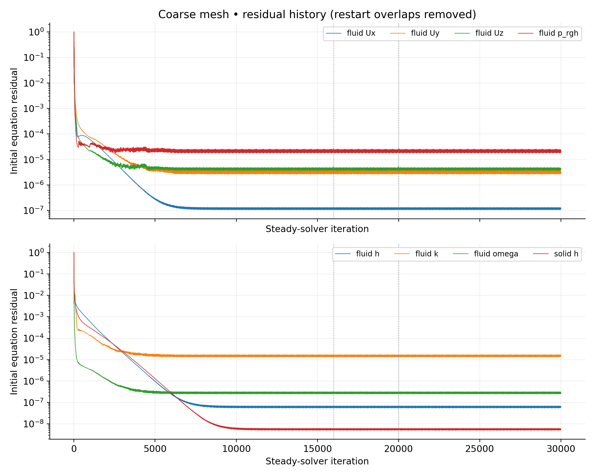
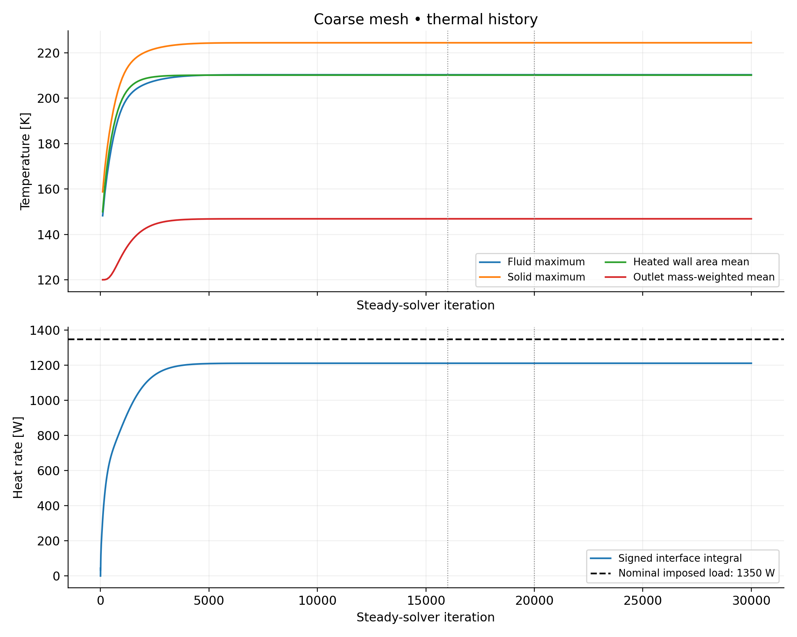
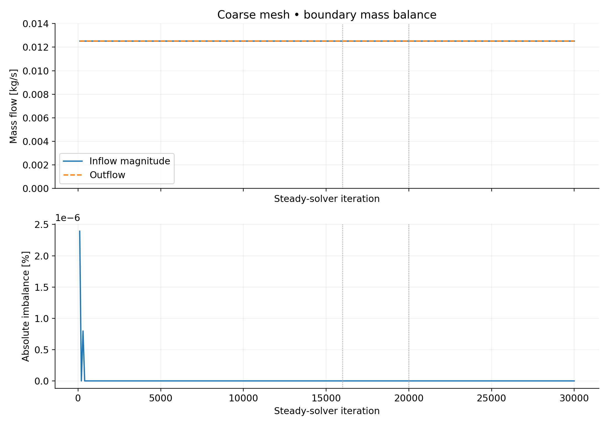
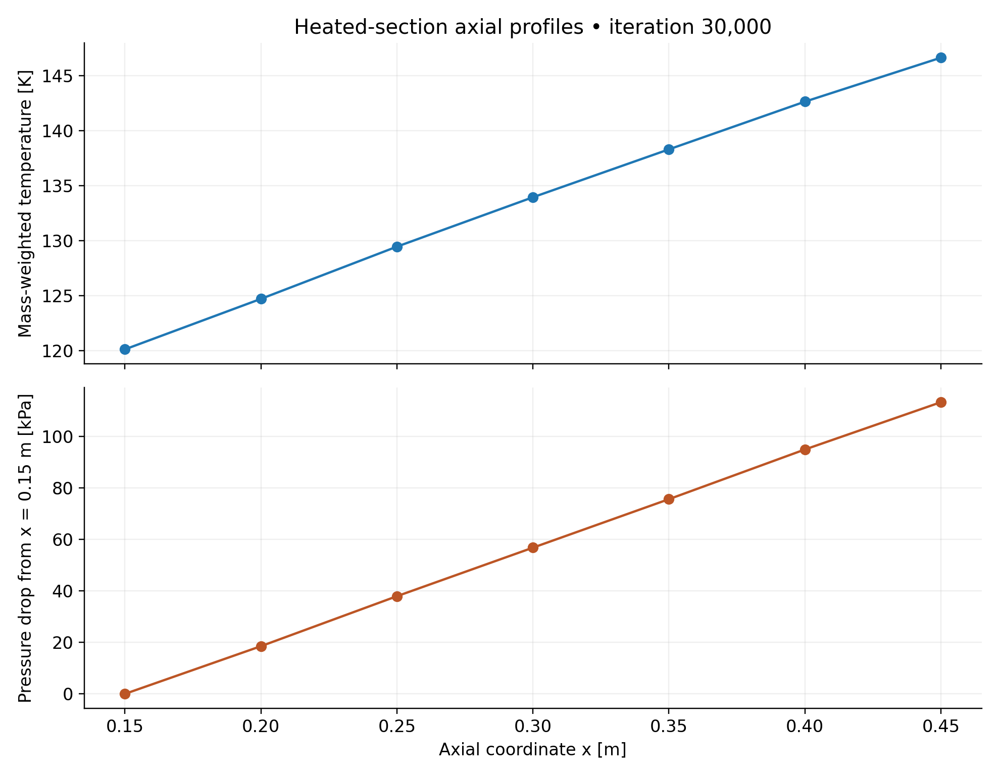
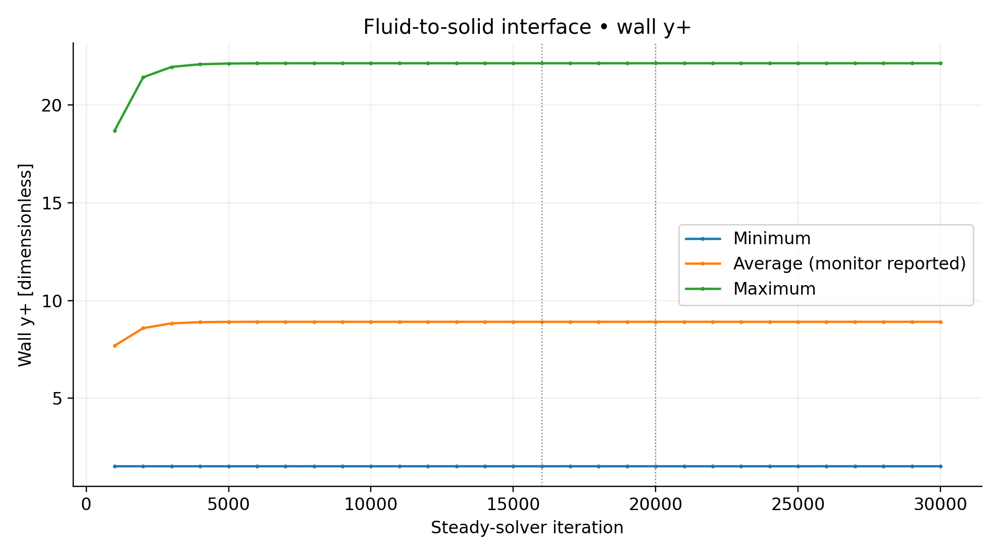
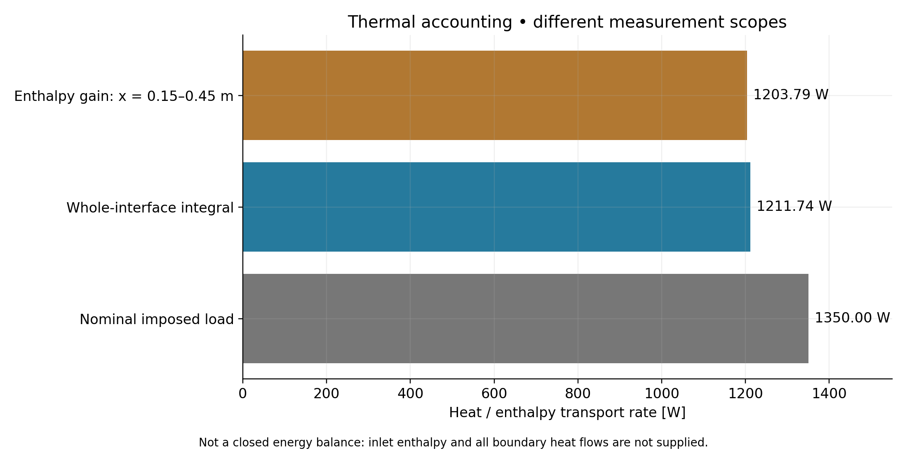

# Coarse-mesh results

Results extracted from the supplied OpenFOAM logs and postProcessing files. The final restart log ends normally at iteration 30,000. These are steady-solver iterations, not physical seconds.

## Final summary

| Quantity | Value | Unit |
|---|---:|---|
| Final saved iteration | 30000 | iteration |
| Fluid cells | 192000 | cells |
| Solid cells | 120000 | cells |
| Maximum fluid temperature | 210.33775 | K |
| Maximum solid temperature | 224.43278 | K |
| Mass-weighted outlet temperature | 146.86075 | K |
| Mean heated exterior wall temperature | 210.17212 | K |
| Interface integral (signed) | 1211.7357 | W |
| Nominal documented imposed heating | 1350 | W |
| Nominal heating minus interface integral | 138.26433 | W |
| Relative difference (nominal load denominator) | 10.241802 | % |
| Heated-section pressure drop | 113.21904 | kPa |
| Heated-section convective enthalpy gain | 1203.793 | W |
| Wall y+ minimum | 1.5181183 | 1 |
| Wall y+ average | 8.9119145 | 1 |
| Wall y+ maximum | 22.14518 | 1 |

## Mass and thermal accounting

| Quantity | Value | Unit | Qualification |
|---|---:|---|---|
| Signed inlet mass flow | -0.012537891 | kg/s | Outward-normal sign convention |
| Signed outlet mass flow | 0.012537891 | kg/s | Outward-normal sign convention |
| Net boundary mass flow | 0 | kg/s | Zero to printed precision |
| Mass imbalance | 0 | % | Relative to inlet magnitude; saved precision only |
| Nominal imposed heat | 1350 | W | Documented assumption; current boundary-condition file absent |
| Whole-interface signed integral | 1211.7357 | W | fluid_to_solid wallHeatFlux monitor |
| Nominal minus interface heat | 138.26433 | W | Unresolved comparison; not a closed system energy residual |
| Relative nominal-interface difference | 10.241802 | % | Denominator 1350 W |
| Plane0-to-plane6 enthalpy transport gain | 1203.793 | W | mdot*(h6-h0); heated-section scope only |
| Full inlet-outlet enthalpy transport gain | not available | W | Inlet enthalpy not monitored; must not assume h_in=0 |
| Full energy balance residual | not established | W | Requires all relevant heat/enthalpy fluxes on a consistent control volume |

## Axial profiles at iteration 30,000

| x (m) | Bulk T (K) | Bulk h (J/kg) | Mean p (MPa) | Mass flow (kg/s) |
|---:|---:|---:|---:|---:|
| 0.15 | 120.14097 | -769466.932 | 8.175184 | 0.01253789 |
| 0.20 | 124.73038 | -753234.577 | 8.156675 | 0.01253789 |
| 0.25 | 129.47725 | -736307.526 | 8.137271 | 0.01253789 |
| 0.30 | 133.96611 | -720152.150 | 8.118433 | 0.01253789 |
| 0.35 | 138.32007 | -704317.255 | 8.099609 | 0.01253789 |
| 0.40 | 142.65590 | -688355.920 | 8.080320 | 0.01253789 |
| 0.45 | 146.65318 | -673454.535 | 8.061965 | 0.01253789 |

## Figures

PNG files are high-resolution previews; SVG files remain sharp at any zoom.













## Interpretation and limitations

- This is a coarse-mesh demonstration. Medium/fine runs were not completed; mesh independence and validation are not established.
- Residual plots use **initial equation residuals**, not the final residuals of individual linear solves. A stable temperature/heat-rate plateau alone does not establish accuracy or energy closure.
- Restart checkpoints are 16,000 and 20,000 (dotted lines). Superseded history after each checkpoint is discarded; the checkpoint sample is retained when present. No interpolation is used. Monitor sampling intervals differ.
- Mass flow is conserved at the recorded precision at the final iteration; this does not imply an exactly zero mathematical error.
- The nominal 1350 W load is based on the previously documented heating, not reverified from a current boundary-condition file in this archive. Its roughly 10.24% difference from the interface integral remains unresolved.
- The plane0-to-plane6 enthalpy gain uses measured enthalpies and mass flow. Its control volume differs from the whole-interface monitor. It is not a full energy-balance residual. Enthalpy has a reference offset; inlet enthalpy must not be assumed zero.
- y+ is reported as supplied by the OpenFOAM monitor; the average is not reinterpreted as area weighted. Values alone do not validate the turbulence/wall treatment.
- Axial temperature/enthalpy are phi-weighted face-zone averages; pressure is area averaged. These seven stations describe bulk-fluid profiles, not wall-temperature profiles.
- checkMesh reports Mesh OK for both regions, but the maximum aspect ratio is about 500. Mesh checks do not replace discretization-error assessment.

## Files and reproducibility

Copy this directory into `output/coarse/analysis/` in your repository and link this README from the main README. All CSV files include units in column names or an explicit units column. Retain the original solver logs and monitor files separately; source SHA-256 hashes are included to identify the analyzed inputs.

Requires Python 3, NumPy and Matplotlib. Reproduce from the extracted review archive or original case:

```bash
python3 make_plots.py /path/to/methaneCHT /path/to/new-analysis-output
```

The script expects the three named solver logs, `system/planes.txt` and the supplied monitor directories. Nominal heat load (1350 W) and mesh-quality summary are specific to this reviewed case. Change those values only after checking the corresponding inputs/checkMesh log.
